<p align="center"><a href="./README.en.md"></a></p>

<h1 align="center">Gym Alcetus</h1>

<p align="center">Fitness tracking web app (PWA) with metrics, progress charts and a muscle heatmap.</p>

<p align="center">
  <kbd>&nbsp;&nbsp; React&nbsp;&nbsp;</kbd> &nbsp;<kbd>&nbsp;&nbsp; TypeScript&nbsp;&nbsp;</kbd> &nbsp;<kbd>&nbsp;&nbsp; Vite&nbsp;&nbsp;</kbd> &nbsp;<kbd>&nbsp;&nbsp; Tailwind CSS&nbsp;&nbsp;</kbd> &nbsp;<kbd>&nbsp;&nbsp; Zustand&nbsp;&nbsp;</kbd> &nbsp;<kbd>&nbsp;&nbsp; TanStack Query&nbsp;&nbsp;</kbd> &nbsp;<kbd>&nbsp;&nbsp; Zod&nbsp;&nbsp;</kbd> &nbsp;<kbd>&nbsp;&nbsp; PWA&nbsp;&nbsp;</kbd> &nbsp;<kbd>&nbsp;&nbsp; Fastify&nbsp;&nbsp;</kbd> &nbsp;<kbd>&nbsp;&nbsp; SQLite&nbsp;&nbsp;</kbd> &nbsp;<kbd>&nbsp;&nbsp; Drizzle ORM&nbsp;&nbsp;</kbd> &nbsp;<kbd>&nbsp;&nbsp; Docker&nbsp;&nbsp;</kbd> &nbsp;<kbd>&nbsp;&nbsp; Nginx&nbsp;&nbsp;</kbd>
</p>

<p align="center"><a href="./README.md"></a> &nbsp; <a href="./README.en.md"></a></p>

> Demo: [gym.alcetus.com](https://gym.alcetus.com).

<table>
<tr>
<td align="center" width="33%"><b>50</b><br><sub>exercises in the catalog</sub></td><td align="center" width="33%"><b>1RM</b><br><sub>estimated with Epley</sub></td><td align="center" width="33%"><b>Offline</b><br><sub>installable PWA</sub></td>
</tr>
</table>

### Overview

Gym Alcetus is an installable workout app (PWA) with a React 19 front end and its own Fastify 5 API. You build your workouts and a weekly plan, run each session set by set with a rest timer, and then follow your progress in charts, a muscle map and body weight.

Each person's data lives in a SQLite (libSQL) database accessed through Drizzle. Sign-in just goes through Google, and the session becomes a JWT cookie. One container serves both the API and the built front end.

### How it works

1. The user signs in with a Google account. The browser sends the identity token to the API, which validates it, creates or updates the user and returns a session cookie.
2. On first access, a 3-step wizard (profile, goals with focus muscles, review) completes the profile.
3. They pick exercises from the catalog, build a workout (sets, reps, rest, target load) and place workouts on the days of a weekly plan.
4. At training time, the runner screen guides every set. Completing a set starts the rest period on its own.
5. On finish, the app saves the session and all its sets in a single transaction.
6. History, progress and muscle map screens read those sessions and compute everything in the browser.

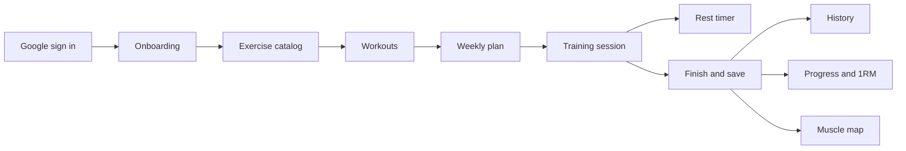

### Features in detail

#### Authentication

Sign-in uses Google Identity Services on the front end. The API receives the credential at `POST /api/auth/google`, checks the token signature and audience, and rejects unverified emails.

<p align="center">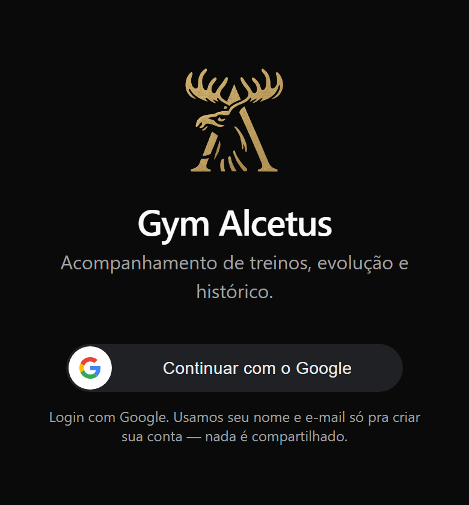<br><sub>Login screen with the Continue with Google button.</sub></p>

- It creates the user the first time and updates email and picture afterwards.
- It signs an HS256 JWT with the jose library, with issuer, audience and a 30-day lifetime.
- The JWT goes into an httpOnly, sameSite lax cookie, secure in production.
- A hook loads the user on every request. An invalid cookie or a missing user clears the cookie, including the broad-domain one.
- The server sets Cross-Origin-Opener-Policy to same-origin-allow-popups, because some proxies blocked the Google popup from reporting back.

#### Exercise catalog

The official catalog comes from a seed file and is shared by everyone. Each person can create their own exercises.

<p align="center">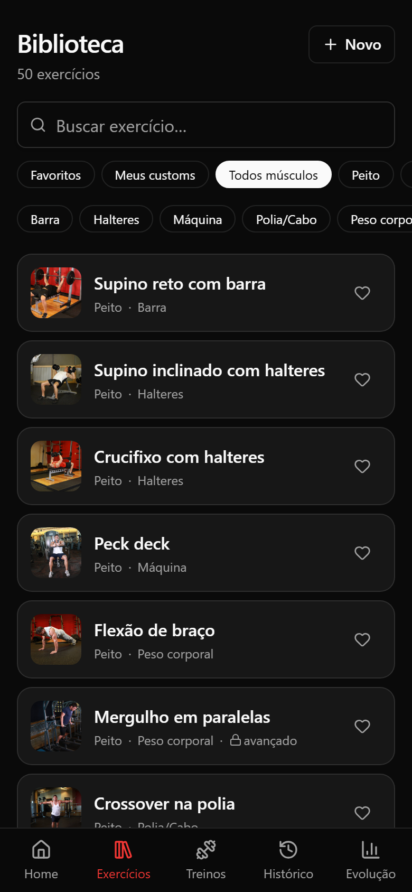<br><sub>Exercise library with search, muscle and equipment filters, favorites and exercise photos.</sub></p>

- The current seed has 50 exercises (6 of them cardio), 13 muscle groups and instructions in Portuguese.
- On boot, the API runs migrations and inserts only what is missing, so new exercises arrive without rewriting old ones.
- Photos sit in a folder and are linked to the exercise by file name, which is the exercise id.
- The library filters by search, muscle, equipment, favorites and own exercises.

#### Workouts and weekly plan

A workout has a mode (hypertrophy or strength), a color, notes and up to 40 exercises. Each exercise sets the number of sets, a rep range, rest and a target load. Cardio uses duration and distance instead of load and reps.

<p align="center">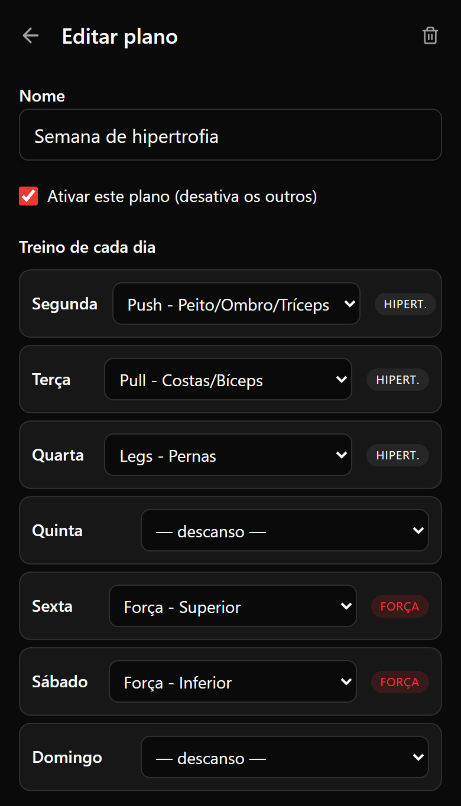<br><sub>Plan editor: each weekday points to a workout or to a rest day.</sub></p>

<p align="center">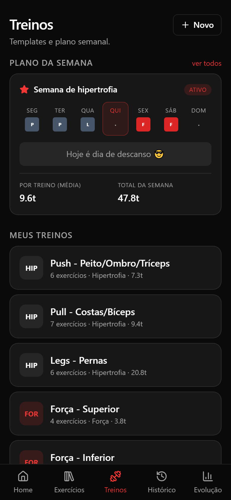<br><sub>Active weekly plan (one workout per day, Thursday as rest) and the workout list with mode and estimated volume.</sub></p>

- There are 6 ready-made templates, such as Push, Pull, Legs and two strength days.
- The plan has 7 days. A day without a workout is a rest day.
- Only one plan is active per user, and switching happens in a transaction.
- Deleting a workout turns its days into rest days.
- The volume estimate uses the last real load for the exercise, or the target load, times the mean of the rep range.

#### Session runner and rest timer

The screen alternates between set mode and rest mode. Load and reps are typed in, and a shortcut button fills them from the last record.

<p align="center">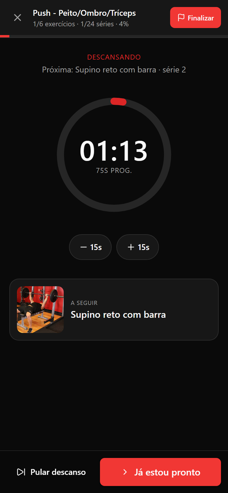<br><sub>Circular rest timer with 15-second adjustment and a preview of the next exercise.</sub></p>

<p align="center">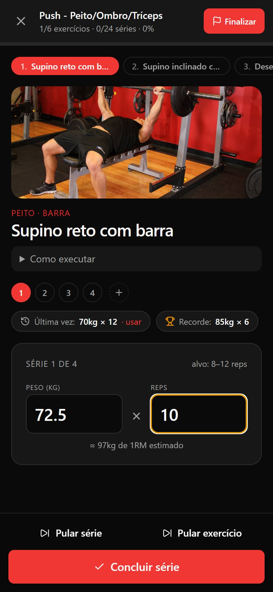<br><sub>Current set with typed weight and reps, last-time shortcut, record and live estimated 1RM.</sub></p>

- The estimated 1RM shows up while the user types.
- Completing a set triggers the configured rest. It can be adjusted by 15 seconds either way and advances on its own at zero.
- The timer stores the start instant, not a counter. That is why it survives a backgrounded tab, a closed app and multiple tabs, which sync through the storage event.
- At zero it vibrates and plays an 880 Hz beep generated by the Web Audio API, with no sound file.
- Users can skip a set, skip an exercise and add extra sets.
- The last set counts even with asynchronous React state, because drafts are updated by a pure function before finishing.

#### Progress, 1RM and volume

The Progress screen filters by exercise or by muscle and by period (today, week starting Monday, month, all, or a custom range).

<p align="center">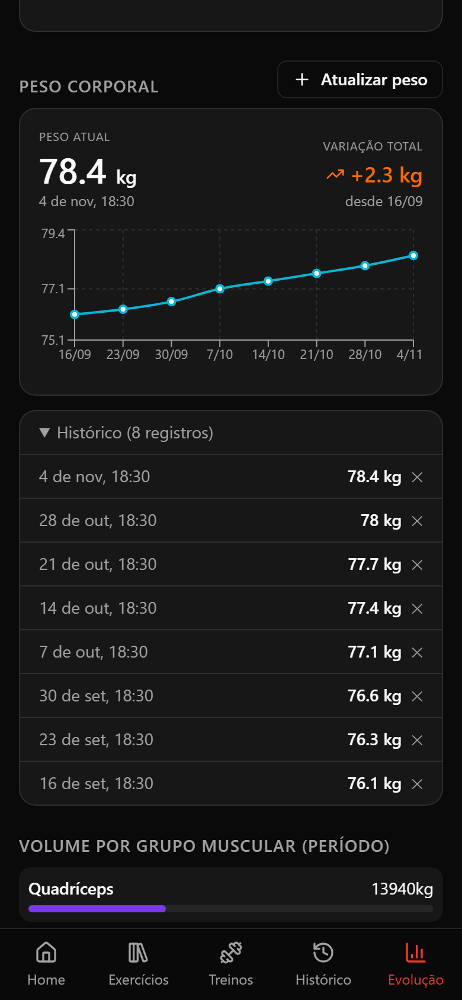<br><sub>Body weight chart, entry history and volume per muscle group.</sub></p>

<p align="center">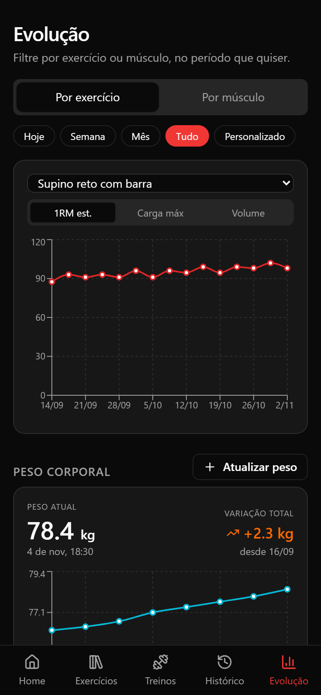<br><sub>Estimated 1RM chart for the bench press over eight weeks, with period and metric filters.</sub></p>

- The screen offers three metrics: estimated 1RM, max load and volume.
- 1RM uses Epley: load times (1 plus reps divided by 30). With 1 rep it equals the load itself, and zero inputs give 0.
- The line charts use Recharts, with one point per session.
- A panel shows the volume distribution by muscle.
- Body weight has its own screen, with a chart and history, and a new weight updates the profile.

#### Muscle map

Two SVG figures (front and back) paint the muscles worked in the session.

<p align="center">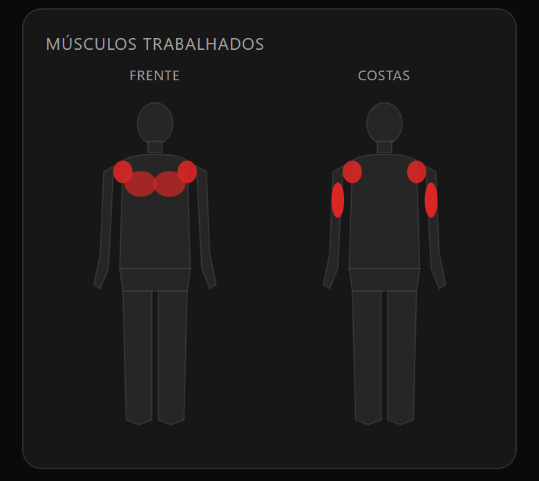<br><sub>Front and back figures highlighting the muscles worked in a Push session.</sub></p>

- A set on the primary muscle counts 1.0 and on a secondary muscle counts 0.5.
- The sum is normalized by the most worked muscle.
- Red opacity runs from 0.25 to 1.0.

### Architecture and stack

Front end and API share one repository. Fastify serves the API under `/api`, exercise images with one-year caching, and the front-end build with a fallback to `index.html` so the React router works.

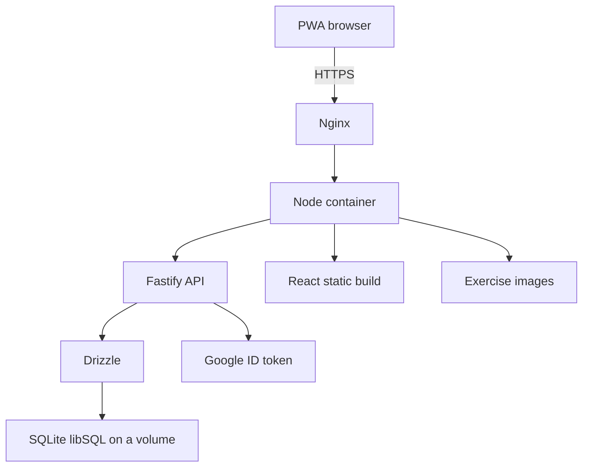

- The front end uses React 19, TypeScript, Vite, Tailwind, Zustand, TanStack Query, React Hook Form with Zod, Recharts and a Workbox PWA.
- The back end uses Fastify 5, libSQL, Drizzle with 3 migrations, jose, google-auth-library and Zod on the routes.
- The infra has a 3-stage Dockerfile (front end, server, final Node 22 Alpine image running as an unprivileged user), a compose file with a data volume and a healthcheck, and Nginx with TLS, HSTS and long caching on assets.

### Engineering decisions

- **Save the session only at the end.** The API receives all sets in one PUT and replaces them in a transaction. That avoids half-saved sets, and the "last time" statistics never mix in what the user is typing.
- **Timestamp-based timer.** Interval counters freeze in hidden tabs on iOS. Storing start and duration and recomputing every 250 ms solves it.
- **Calculations on the client.** 1RM, volume and the heatmap come from sessions already loaded, with no aggregation endpoints, which keeps the API small.
- **httpOnly cookie with JWT.** The token is not reachable from JavaScript, and the 30-day expiry avoids repeated logins.

### Known limits

- RPE exists in the database and the API, but the runner screen still sends that field empty.
- The personal-records table and the record flag exist in the schema, but no route fills them (sets are saved with the record flag false).
- dnd-kit is listed in the dependencies but is not imported in the front-end code.
- The code has no offline write queue: the PWA caches the app and images, and saving requires the server.

### Getting started

```bash
# Front-end (root)
npm install
npm run dev

# Back-end (server/ folder)
cd server
npm install
npm run db:migrate   # create the database schema
npm run db:seed      # seed the exercise catalog
npm run dev
```

Create a `.env` file in `server/` with your Google OAuth credentials and the database URL (libSQL/SQLite).

<sub>Contact: <a href="https://joaocouto.alcetus.com">joaocouto.alcetus.com</a> · <a href="mailto:joaopecouto77@gmail.com">joaopecouto77@gmail.com</a></sub>
