<p align="center"></p>

<h1 align="center">Gym Alcetus</h1>

<p align="center">App web de acompanhamento de treino (PWA) com métricas, gráficos de evolução e heatmap muscular.</p>

<p align="center">
  <kbd>&nbsp;&nbsp; React&nbsp;&nbsp;</kbd> &nbsp;<kbd>&nbsp;&nbsp; TypeScript&nbsp;&nbsp;</kbd> &nbsp;<kbd>&nbsp;&nbsp; Vite&nbsp;&nbsp;</kbd> &nbsp;<kbd>&nbsp;&nbsp; Tailwind CSS&nbsp;&nbsp;</kbd> &nbsp;<kbd>&nbsp;&nbsp; Zustand&nbsp;&nbsp;</kbd> &nbsp;<kbd>&nbsp;&nbsp; TanStack Query&nbsp;&nbsp;</kbd> &nbsp;<kbd>&nbsp;&nbsp; Zod&nbsp;&nbsp;</kbd> &nbsp;<kbd>&nbsp;&nbsp; PWA&nbsp;&nbsp;</kbd> &nbsp;<kbd>&nbsp;&nbsp; Fastify&nbsp;&nbsp;</kbd> &nbsp;<kbd>&nbsp;&nbsp; SQLite&nbsp;&nbsp;</kbd> &nbsp;<kbd>&nbsp;&nbsp; Drizzle ORM&nbsp;&nbsp;</kbd> &nbsp;<kbd>&nbsp;&nbsp; Docker&nbsp;&nbsp;</kbd> &nbsp;<kbd>&nbsp;&nbsp; Nginx&nbsp;&nbsp;</kbd>
</p>

<p align="center"> &nbsp; <a href="./README.en.md"></a></p>

> Demo: [gym.alcetus.com](https://gym.alcetus.com).

<table>
<tr>
<td align="center" width="33%"><b>50</b><br><sub>exercícios no catálogo</sub></td><td align="center" width="33%"><b>1RM</b><br><sub>estimado por Epley</sub></td><td align="center" width="33%"><b>Offline</b><br><sub>PWA instalável</sub></td>
</tr>
</table>

### Visão geral

O Gym Alcetus é um app de treino instalável (PWA) com front-end em React 19 e uma API própria em Fastify 5. Você monta treinos e um plano semanal, executa a sessão série por série com cronômetro de descanso e depois acompanha a evolução em gráficos, num mapa muscular e em peso corporal.

Todo o dado de cada pessoa fica em um banco SQLite (libSQL), acessado com Drizzle. O login é feito pelo Google e a sessão vira um cookie com JWT. O mesmo container serve a API e o front compilado.

### Como funciona

1. A pessoa entra com a conta Google. O navegador envia o token de identidade para a API, que o valida, cria ou atualiza o usuário e devolve um cookie de sessão.
2. No primeiro acesso, um assistente de 3 etapas (perfil, objetivos com músculos de foco, revisão) completa o cadastro.
3. Ela escolhe exercícios no catálogo, monta um treino (séries, repetições, descanso, carga alvo) e encaixa os treinos nos dias de um plano semanal.
4. Na hora de treinar, a tela de execução guia cada série. Ao concluir uma série, o descanso começa sozinho.
5. Ao finalizar, o app grava a sessão e todas as séries em uma transação única.
6. As telas de histórico, evolução e mapa muscular leem essas sessões e calculam tudo no navegador.

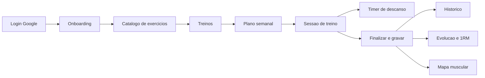

### Funcionalidades em detalhe

#### Autenticação

O login usa Google Identity Services no front. A API recebe o credential em `POST /api/auth/google`, confere a assinatura e o público do token, e recusa e-mails não verificados.

<p align="center">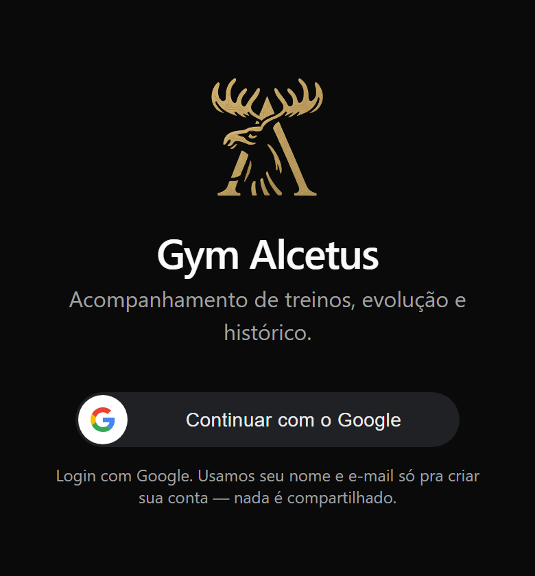<br><sub>Tela de login com o botão Continuar com o Google.</sub></p>

- Cria o usuário na primeira vez e atualiza e-mail e foto nas seguintes.
- Assina um JWT HS256 com a biblioteca jose, com emissor, público e validade de 30 dias.
- Grava o JWT em cookie httpOnly, sameSite lax, secure em produção.
- Um hook carrega o usuário em toda requisição. Cookie inválido ou usuário inexistente apaga o cookie, inclusive o de domínio amplo.
- O servidor define o cabeçalho Cross-Origin-Opener-Policy como same-origin-allow-popups, porque alguns proxies bloqueavam o retorno do popup do Google.

#### Catálogo de exercícios

O catálogo oficial vem de um arquivo de seed e é compartilhado por todos. Cada pessoa pode criar exercícios próprios.

<p align="center">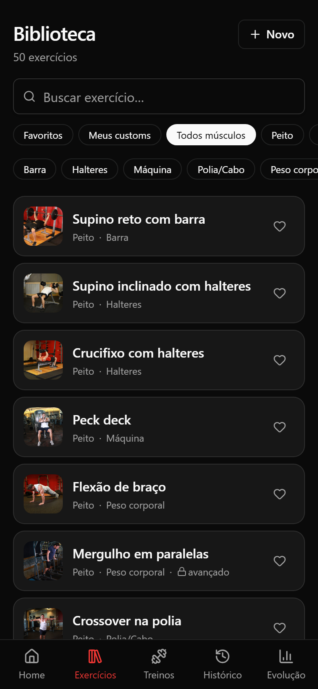<br><sub>Biblioteca com busca, filtros por músculo e equipamento, favoritos e fotos dos exercícios.</sub></p>

- A seed atual tem 50 exercícios (6 de cardio), 13 grupos musculares e instruções em português.
- No boot, a API aplica migrations e insere só o que falta, então novos exercícios entram sem regravar os antigos.
- As fotos ficam em uma pasta e são ligadas ao exercício pelo nome do arquivo, que é o id do exercício.
- A biblioteca filtra por busca, músculo, equipamento, favoritos e exercícios próprios.

#### Treinos e plano semanal

Um treino tem modo (hipertrofia ou força), cor, notas e até 40 exercícios. Cada exercício define séries, faixa de repetições, descanso e carga alvo. Cardio usa duração e distância no lugar de carga e repetições.

<p align="center">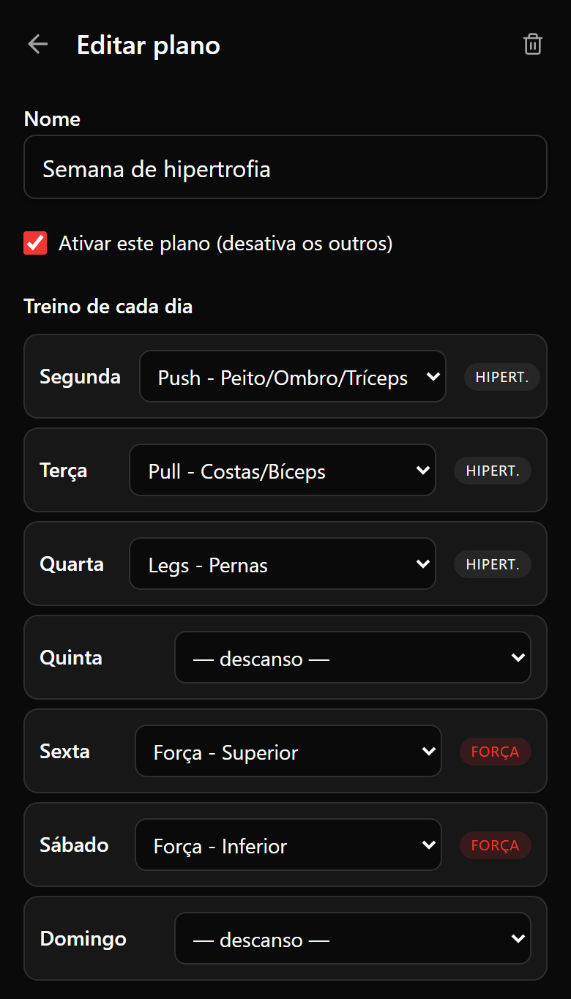<br><sub>Editor do plano: cada dia da semana aponta para um treino ou para descanso.</sub></p>

<p align="center">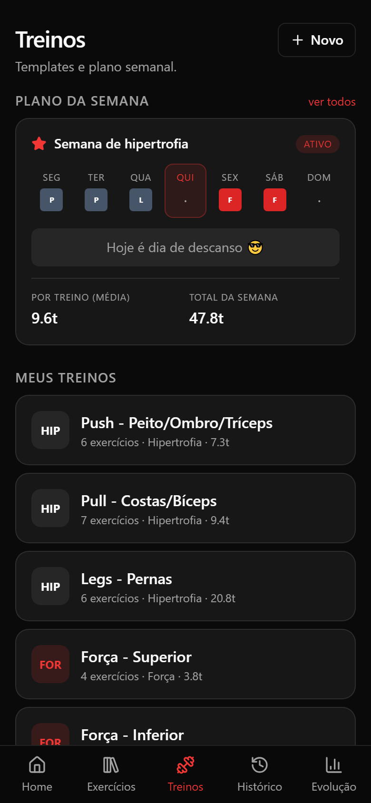<br><sub>Plano da semana ativo (um treino por dia, quinta como descanso) e a lista de treinos com modo e volume estimado.</sub></p>

- Existem 6 modelos prontos, como Push, Pull, Legs e dois treinos de força.
- O plano tem 7 dias. Dia sem treino é descanso.
- Só um plano fica ativo por usuário, e a troca ocorre numa transação.
- Apagar um treino transforma os dias dele em descanso.
- A estimativa de volume usa a última carga real do exercício, ou a carga alvo, vezes a média das repetições.

#### Execução da sessão e timer de descanso

A tela alterna entre modo série e modo descanso. A carga e as repetições são digitadas, e o botão de atalho preenche com o último registro.

<p align="center">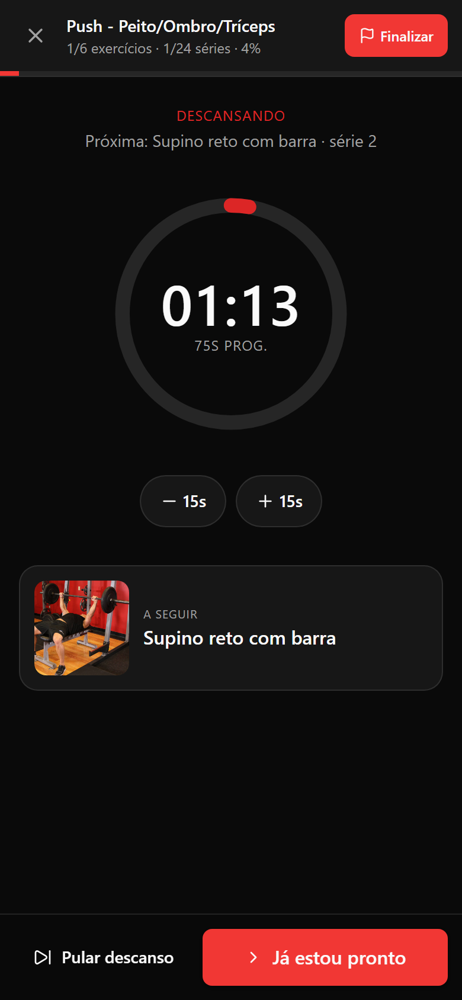<br><sub>Timer de descanso circular com ajuste de 15 segundos e prévia do próximo exercício.</sub></p>

<p align="center">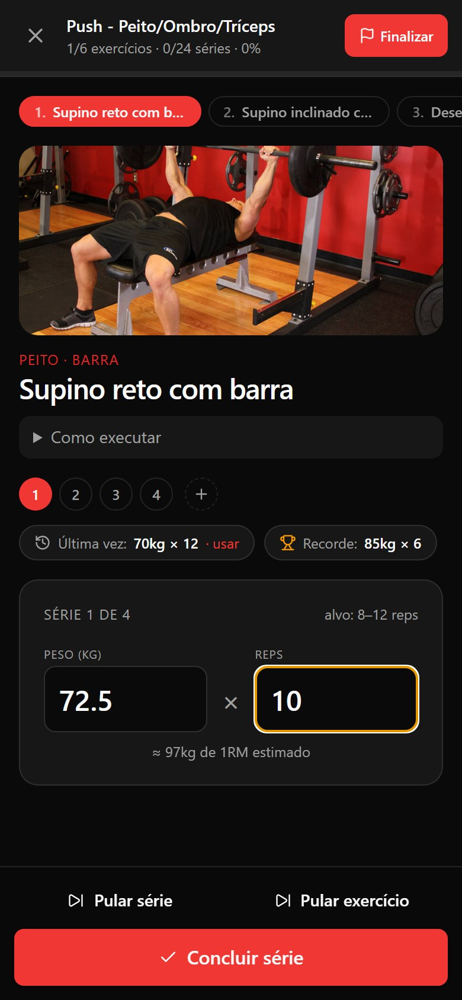<br><sub>Série atual com carga e repetições digitadas, atalho da última vez, recorde e 1RM estimado em tempo real.</sub></p>

- O 1RM estimado aparece enquanto a pessoa digita.
- Concluir a série dispara o descanso configurado. Ele aceita ajuste de 15 segundos para mais ou menos e avança sozinho quando zera.
- O timer guarda o instante de início, não um contador. Por isso sobrevive a aba em segundo plano, app fechado e várias abas, sincronizadas pelo evento de storage.
- Ao zerar, vibra e toca um beep de 880 Hz gerado pela Web Audio API, sem arquivo de som.
- Dá para pular série, pular exercício e adicionar séries extras.
- A última série entra no cálculo mesmo com o estado de React assíncrono, porque os rascunhos são atualizados por função pura antes de finalizar.

#### Evolução, 1RM e volume

A tela Evolução filtra por exercício ou por músculo e por período (hoje, semana com início na segunda, mês, tudo ou intervalo livre).

<p align="center">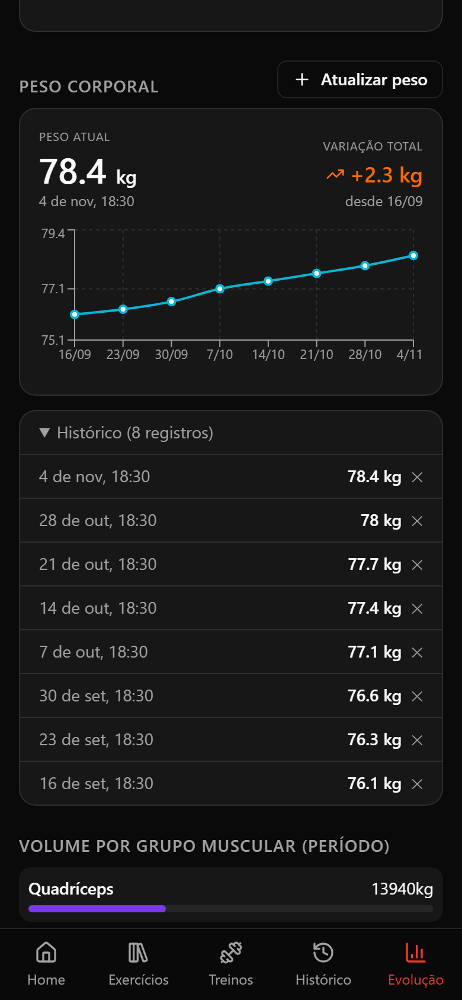<br><sub>Peso corporal com gráfico, histórico de registros e volume por grupo muscular.</sub></p>

<p align="center">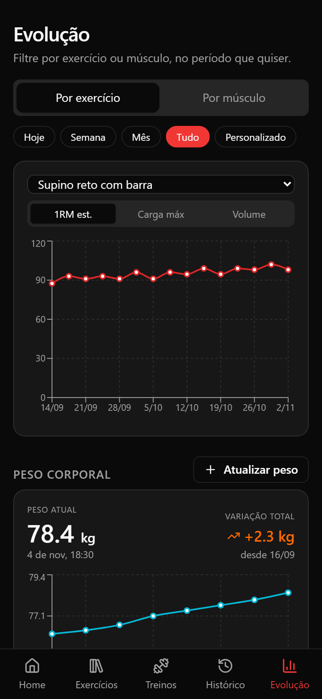<br><sub>Gráfico de 1RM estimado do supino ao longo de oito semanas, com filtros de período e métrica.</sub></p>

- Três métricas: 1RM estimado, carga máxima e volume.
- O 1RM usa Epley: carga vezes (1 mais repetições dividido por 30). Com 1 repetição vale a própria carga, e valores zerados dão 0.
- Gráficos de linha em Recharts, com ponto por sessão.
- Um painel mostra a distribuição de volume por músculo.
- O peso corporal tem tela própria, com gráfico e histórico, e o peso novo atualiza o perfil.

#### Mapa muscular

Dois bonecos em SVG (frente e costas) pintam os músculos trabalhados na sessão.

<p align="center">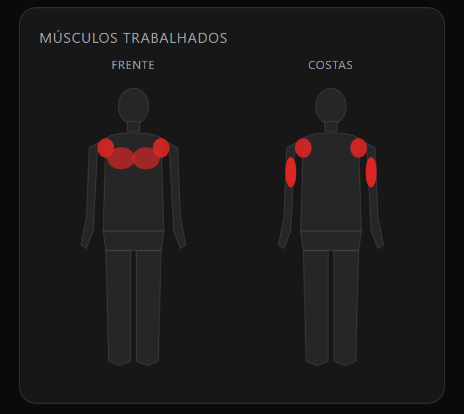<br><sub>Bonecos de frente e costas pintando os músculos trabalhados em uma sessão de Push.</sub></p>

- Série no músculo principal vale 1,0 e no secundário vale 0,5.
- A soma é normalizada pelo músculo mais exigido.
- A opacidade do vermelho vai de 0,25 a 1,0.

### Arquitetura e stack

Front e API vivem no mesmo repositório. O Fastify serve a API em `/api`, as imagens com cache de um ano e o build do front com fallback para o `index.html`, para o roteador do React funcionar.

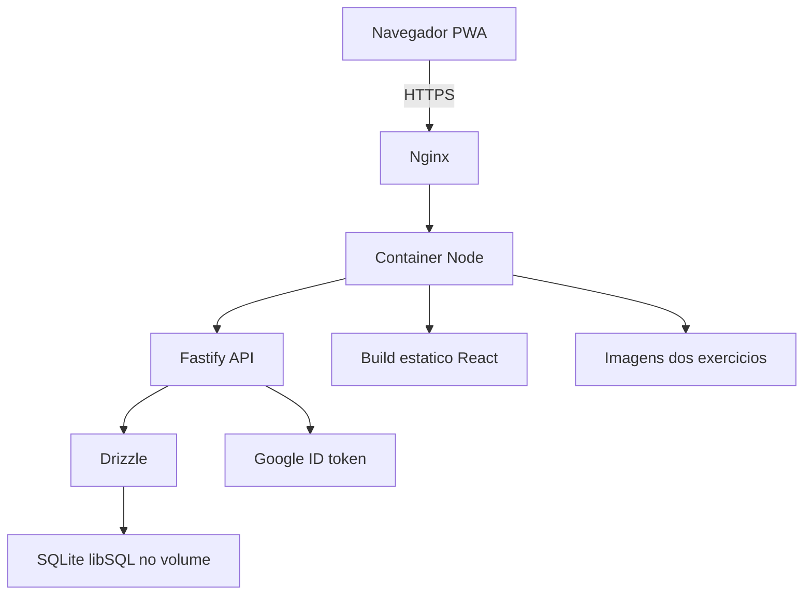

- Front: React 19, TypeScript, Vite, Tailwind, Zustand, TanStack Query, React Hook Form com Zod, Recharts e PWA com Workbox.
- Back: Fastify 5, libSQL, Drizzle com 3 migrations, jose, google-auth-library e Zod nas rotas.
- Infra: Dockerfile em 3 estágios (front, servidor, imagem final em Node 22 Alpine, usuário sem privilégio), compose com volume de dados e healthcheck, e Nginx com TLS, HSTS e cache longo nos assets.

### Decisões de engenharia

- **Gravar a sessão só no fim.** A API recebe todas as séries em um único PUT e troca tudo numa transação. Isso evita séries meio gravadas, e as estatísticas de "última vez" nunca misturam o que a pessoa está digitando.
- **Timer baseado em timestamp.** Contadores de intervalo congelam em aba oculta no iOS. Guardar início e duração e recalcular a cada 250 ms resolve isso.
- **Cálculos no cliente.** 1RM, volume e heatmap saem das sessões já carregadas, sem endpoints de agregação, o que mantém a API pequena.
- **Cookie httpOnly com JWT.** O token não fica acessível ao JavaScript, e a expiração de 30 dias evita logins repetidos.

### Limites conhecidos

- O RPE existe no banco e na API, mas a tela de execução ainda envia esse campo vazio.
- A tabela de recordes pessoais e a marcação de recorde existem no schema, mas nenhuma rota as preenche (as séries são gravadas com recorde falso).
- O dnd-kit está nas dependências, mas não é importado no código do front.
- O código não tem fila de escrita offline: o PWA guarda o app e as imagens, e gravar exige o servidor.

### Como rodar

```bash
# Front-end (raiz)
npm install
npm run dev

# Back-end (pasta server/)
cd server
npm install
npm run db:migrate   # cria o schema do banco
npm run db:seed      # popula o catálogo de exercícios
npm run dev
```

Crie um arquivo `.env` em `server/` com as credenciais do Google OAuth e a URL do banco (libSQL/SQLite).

<sub>Contato: <a href="https://joaocouto.alcetus.com">joaocouto.alcetus.com</a> · <a href="mailto:joaopecouto77@gmail.com">joaopecouto77@gmail.com</a></sub>
