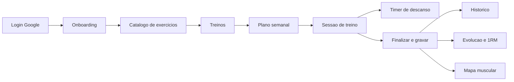
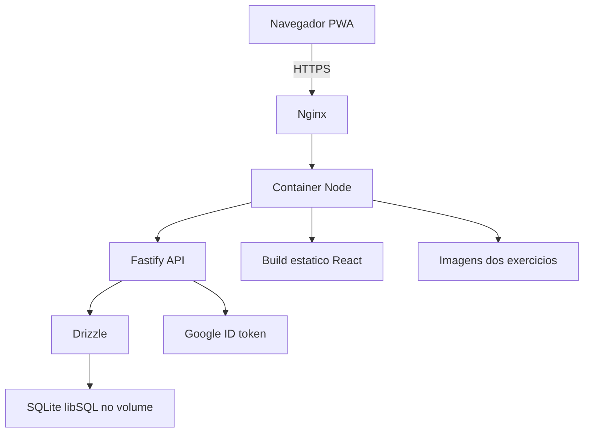
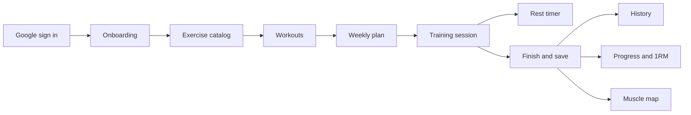
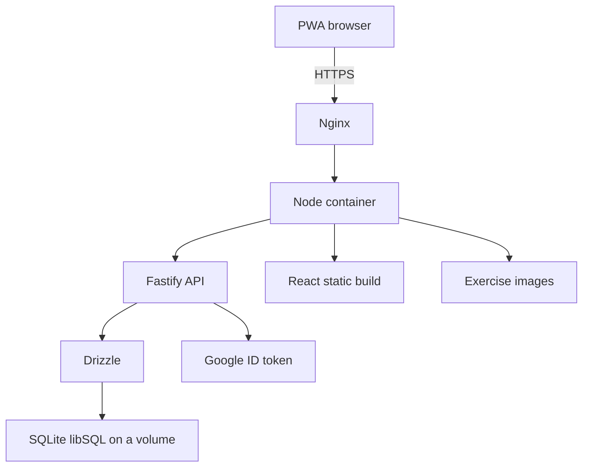

<p align="center"></p>

<h1 align="center">Gym Alcetus</h1>

<p align="center">App web de acompanhamento de treino (PWA) com métricas, gráficos de evolução e heatmap muscular.<br><sub><i>Fitness tracking web app (PWA) with metrics, progress charts and a muscle heatmap.</i></sub></p>

<p align="center">
  <kbd> React</kbd> <kbd> TypeScript</kbd> <kbd> Vite</kbd> <kbd> Tailwind CSS</kbd> <kbd> Zustand</kbd> <kbd> TanStack Query</kbd> <kbd> Zod</kbd> <kbd> PWA</kbd> <kbd> Fastify</kbd> <kbd> SQLite</kbd> <kbd> Drizzle ORM</kbd> <kbd> Docker</kbd> <kbd> Nginx</kbd>
</p>

<p align="center"><a href="#portugu%C3%AAs"><b>Português</b></a> &nbsp;|&nbsp; <a href="#english"><b>English</b></a></p>

> **PT** Demo: [gym.alcetus.com](https://gym.alcetus.com).
> **EN** Demo: [gym.alcetus.com](https://gym.alcetus.com).

## Português

<table>
<tr>
<td align="center" width="33%"><b>50</b><br><sub>exercícios no catálogo</sub></td><td align="center" width="33%"><b>1RM</b><br><sub>estimado por Epley</sub></td><td align="center" width="33%"><b>Offline</b><br><sub>PWA instalável</sub></td>
</tr>
</table>

### Visão geral

O Gym Alcetus é um app de treino instalável (PWA) com front-end em React 19 e uma API própria em Fastify 5. Você monta treinos e um plano semanal, executa a sessão série por série com cronômetro de descanso e depois acompanha a evolução em gráficos, num mapa muscular e em medidas corporais.

Todo o dado de cada pessoa fica em um banco SQLite (libSQL), acessado com Drizzle. O login é feito pelo Google e a sessão vira um cookie com JWT. O mesmo container serve a API e o front compilado.

### Como funciona

1. A pessoa entra com a conta Google. O navegador envia o token de identidade para a API, que o valida, cria ou atualiza o usuário e devolve um cookie de sessão.
2. No primeiro acesso, um assistente de 3 etapas (perfil, objetivos com músculos de foco, revisão) completa o cadastro.
3. Ela escolhe exercícios no catálogo, monta um treino (séries, repetições, descanso, carga alvo) e encaixa os treinos nos dias de um plano semanal.
4. Na hora de treinar, a tela de execução guia cada série. Ao concluir uma série, o descanso começa sozinho.
5. Ao finalizar, o app grava a sessão e todas as séries em uma transação única.
6. As telas de histórico, evolução e mapa muscular leem essas sessões e calculam tudo no navegador.



### Funcionalidades em detalhe

#### Autenticação

O login usa Google Identity Services no front. A API recebe o credential em `POST /api/auth/google`, confere a assinatura e o público do token, e recusa e-mails não verificados.

- Cria o usuário na primeira vez e atualiza e-mail e foto nas seguintes.
- Assina um JWT HS256 com a biblioteca jose, com emissor, público e validade de 30 dias.
- Grava o JWT em cookie httpOnly, sameSite lax, secure em produção.
- Um hook carrega o usuário em toda requisição. Cookie inválido ou usuário inexistente apaga o cookie, inclusive o de domínio amplo.
- O servidor define o cabeçalho Cross-Origin-Opener-Policy como same-origin-allow-popups, porque alguns proxies bloqueavam o retorno do popup do Google.

#### Catálogo de exercícios

O catálogo oficial vem de um arquivo de seed e é compartilhado por todos. Cada pessoa pode criar exercícios próprios.

- A seed atual tem 50 exercícios (6 de cardio), 13 grupos musculares e instruções em português.
- No boot, a API aplica migrations e insere só o que falta, então novos exercícios entram sem regravar os antigos.
- As fotos ficam em uma pasta e são ligadas ao exercício pelo nome do arquivo, que é o id do exercício.
- A biblioteca filtra por busca, músculo, equipamento, favoritos e exercícios próprios.

#### Treinos e plano semanal

Um treino tem modo (hipertrofia ou força), cor, notas e até 40 exercícios. Cada exercício define séries, faixa de repetições, descanso e carga alvo. Cardio usa duração e distância no lugar de carga e repetições.

- Existem 6 modelos prontos, como Push, Pull, Legs e dois treinos de força.
- O plano tem 7 dias. Dia sem treino é descanso.
- Só um plano fica ativo por usuário, e a troca ocorre numa transação.
- Apagar um treino transforma os dias dele em descanso.
- A estimativa de volume usa a última carga real do exercício, ou a carga alvo, vezes a média das repetições.

#### Execução da sessão e timer de descanso

A tela alterna entre modo série e modo descanso. A carga e as repetições são digitadas, e o botão de atalho preenche com o último registro.

- O 1RM estimado aparece enquanto a pessoa digita.
- Concluir a série dispara o descanso configurado. Ele aceita ajuste de 15 segundos para mais ou menos e avança sozinho quando zera.
- O timer guarda o instante de início, não um contador. Por isso sobrevive a aba em segundo plano, app fechado e várias abas, sincronizadas pelo evento de storage.
- Ao zerar, vibra e toca um beep de 880 Hz gerado pela Web Audio API, sem arquivo de som.
- Dá para pular série, pular exercício e adicionar séries extras.
- A última série entra no cálculo mesmo com o estado de React assíncrono, porque os rascunhos são atualizados por função pura antes de finalizar.

#### Evolução, 1RM e volume

A tela Evolução filtra por exercício ou por músculo e por período (hoje, semana com início na segunda, mês, tudo ou intervalo livre).

- Três métricas: 1RM estimado, carga máxima e volume.
- O 1RM usa Epley: carga vezes (1 mais repetições dividido por 30). Com 1 repetição vale a própria carga, e valores zerados dão 0.
- Gráficos de linha em Recharts, com ponto por sessão.
- Um painel mostra a distribuição de volume por músculo.
- Peso corporal e medidas (gordura, peito, cintura, braços, coxas, panturrilhas) têm tela própria, e o peso novo atualiza o perfil.

#### Mapa muscular

Dois bonecos em SVG (frente e costas) pintam os músculos trabalhados na sessão.

- Série no músculo principal vale 1,0 e no secundário vale 0,5.
- A soma é normalizada pelo músculo mais exigido.
- A opacidade do vermelho vai de 0,25 a 1,0.

### Arquitetura e stack

Front e API vivem no mesmo repositório. O Fastify serve a API em `/api`, as imagens com cache de um ano e o build do front com fallback para o `index.html`, para o roteador do React funcionar.



- Front: React 19, TypeScript, Vite, Tailwind, Zustand, TanStack Query, React Hook Form com Zod, Recharts e PWA com Workbox.
- Back: Fastify 5, libSQL, Drizzle com 3 migrations, jose, google-auth-library e Zod nas rotas.
- Infra: Dockerfile em 3 estágios (front, servidor, imagem final em Node 22 Alpine, usuário sem privilégio), compose com volume de dados e healthcheck, e Nginx com TLS, HSTS e cache longo nos assets.

### Decisões de engenharia

- **Gravar a sessão só no fim.** A API recebe todas as séries em um único PUT e troca tudo numa transação. Isso evita séries meio gravadas, e as estatísticas de "última vez" nunca misturam o que a pessoa está digitando.
- **Timer baseado em timestamp.** Contadores de intervalo congelam em aba oculta no iOS. Guardar início e duração e recalcular a cada 250 ms resolve isso.
- **Cálculos no cliente.** 1RM, volume e heatmap saem das sessões já carregadas, sem endpoints de agregação, o que mantém a API pequena.
- **Cookie httpOnly com JWT.** O token não fica acessível ao JavaScript, e a expiração de 30 dias evita logins repetidos.

### Limites conhecidos

- O RPE existe no banco e na API, mas a tela de execução ainda envia esse campo vazio.
- A tabela de recordes pessoais e a marcação de recorde existem no schema, mas nenhuma rota as preenche (as séries são gravadas com recorde falso).
- O dnd-kit está nas dependências, mas não é importado no código do front.
- O código não tem fila de escrita offline: o PWA guarda o app e as imagens, e gravar exige o servidor.

### Como rodar

```bash
# Front-end (raiz)
npm install
npm run dev

# Back-end (pasta server/)
cd server
npm install
npm run db:migrate   # cria o schema do banco
npm run db:seed      # popula o catálogo de exercícios
npm run dev
```

Crie um arquivo `.env` em `server/` com as credenciais do Google OAuth e a URL do banco (libSQL/SQLite).

## English

<table>
<tr>
<td align="center" width="33%"><b>50</b><br><sub>exercises in the catalog</sub></td><td align="center" width="33%"><b>1RM</b><br><sub>estimated with Epley</sub></td><td align="center" width="33%"><b>Offline</b><br><sub>installable PWA</sub></td>
</tr>
</table>

### Overview

Gym Alcetus is an installable workout app (PWA) with a React 19 front end and its own Fastify 5 API. You build workouts and a weekly plan, run each session set by set with a rest timer, and then follow your progress in charts, a muscle map and body measurements.

Each person's data lives in a SQLite (libSQL) database accessed through Drizzle. Sign-in goes through Google and the session becomes a JWT cookie. One container serves both the API and the built front end.

### How it works

1. The user signs in with a Google account. The browser sends the identity token to the API, which validates it, creates or updates the user and returns a session cookie.
2. On first access, a 3-step wizard (profile, goals with focus muscles, review) completes the profile.
3. They pick exercises from the catalog, build a workout (sets, reps, rest, target load) and place workouts on the days of a weekly plan.
4. At training time, the runner screen guides every set. Completing a set starts the rest period on its own.
5. On finish, the app saves the session and all its sets in a single transaction.
6. History, progress and muscle map screens read those sessions and compute everything in the browser.



### Features in detail

#### Authentication

Sign-in uses Google Identity Services on the front end. The API receives the credential at `POST /api/auth/google`, checks the token signature and audience, and rejects unverified emails.

- It creates the user the first time and updates email and picture afterwards.
- It signs an HS256 JWT with the jose library, with issuer, audience and a 30-day lifetime.
- The JWT goes into an httpOnly, sameSite lax cookie, secure in production.
- A hook loads the user on every request. An invalid cookie or a missing user clears the cookie, including the broad-domain one.
- The server sets Cross-Origin-Opener-Policy to same-origin-allow-popups, because some proxies blocked the Google popup from reporting back.

#### Exercise catalog

The official catalog comes from a seed file and is shared by everyone. Each person can create their own exercises.

- The current seed has 50 exercises (6 of them cardio), 13 muscle groups and instructions in Portuguese.
- On boot, the API runs migrations and inserts only what is missing, so new exercises arrive without rewriting old ones.
- Photos sit in a folder and are linked to the exercise by file name, which is the exercise id.
- The library filters by search, muscle, equipment, favorites and own exercises.

#### Workouts and weekly plan

A workout has a mode (hypertrophy or strength), a color, notes and up to 40 exercises. Each exercise sets the number of sets, a rep range, rest and a target load. Cardio uses duration and distance instead of load and reps.

- There are 6 ready-made templates, such as Push, Pull, Legs and two strength days.
- The plan has 7 days. A day without a workout is a rest day.
- Only one plan is active per user, and switching happens in a transaction.
- Deleting a workout turns its days into rest days.
- The volume estimate uses the last real load for the exercise, or the target load, times the mean of the rep range.

#### Session runner and rest timer

The screen alternates between set mode and rest mode. Load and reps are typed in, and a shortcut button fills them from the last record.

- The estimated 1RM shows up while the user types.
- Completing a set triggers the configured rest. It can be adjusted by 15 seconds either way and advances on its own at zero.
- The timer stores the start instant, not a counter. That is why it survives a backgrounded tab, a closed app and multiple tabs, which sync through the storage event.
- At zero it vibrates and plays an 880 Hz beep generated by the Web Audio API, with no sound file.
- Users can skip a set, skip an exercise and add extra sets.
- The last set counts even with asynchronous React state, because drafts are updated by a pure function before finishing.

#### Progress, 1RM and volume

The Progress screen filters by exercise or by muscle and by period (today, week starting Monday, month, all, or a custom range).

- Three metrics: estimated 1RM, max load and volume.
- 1RM uses Epley: load times (1 plus reps divided by 30). With 1 rep it equals the load itself, and zero inputs give 0.
- Line charts in Recharts, one point per session.
- A panel shows the volume distribution by muscle.
- Body weight and measurements (body fat, chest, waist, arms, thighs, calves) have their own screen, and a new weight updates the profile.

#### Muscle map

Two SVG figures (front and back) paint the muscles worked in the session.

- A set on the primary muscle counts 1.0 and on a secondary muscle counts 0.5.
- The sum is normalized by the most worked muscle.
- Red opacity runs from 0.25 to 1.0.

### Architecture and stack

Front end and API share one repository. Fastify serves the API under `/api`, exercise images with one-year caching, and the front-end build with a fallback to `index.html` so the React router works.



- Front end: React 19, TypeScript, Vite, Tailwind, Zustand, TanStack Query, React Hook Form with Zod, Recharts and a Workbox PWA.
- Back end: Fastify 5, libSQL, Drizzle with 3 migrations, jose, google-auth-library and Zod on the routes.
- Infra: a 3-stage Dockerfile (front end, server, final Node 22 Alpine image running as an unprivileged user), compose with a data volume and a healthcheck, and Nginx with TLS, HSTS and long caching on assets.

### Engineering decisions

- **Save the session only at the end.** The API receives all sets in one PUT and replaces them in a transaction. That avoids half-saved sets, and the "last time" statistics never mix in what the user is typing.
- **Timestamp-based timer.** Interval counters freeze in hidden tabs on iOS. Storing start and duration and recomputing every 250 ms solves it.
- **Calculations on the client.** 1RM, volume and the heatmap come from sessions already loaded, with no aggregation endpoints, which keeps the API small.
- **httpOnly cookie with JWT.** The token is not reachable from JavaScript, and the 30-day expiry avoids repeated logins.

### Known limits

- RPE exists in the database and the API, but the runner screen still sends that field empty.
- The personal-records table and the record flag exist in the schema, but no route fills them (sets are saved with the record flag false).
- dnd-kit is listed in the dependencies but is not imported in the front-end code.
- The code has no offline write queue: the PWA caches the app and images, and saving requires the server.

### Getting started

```bash
# Front-end (root)
npm install
npm run dev

# Back-end (server/ folder)
cd server
npm install
npm run db:migrate   # create the database schema
npm run db:seed      # seed the exercise catalog
npm run dev
```

Create a `.env` file in `server/` with your Google OAuth credentials and the database URL (libSQL/SQLite).

<sub>Contato · Contact: <a href="https://joaocouto.alcetus.com">joaocouto.alcetus.com</a> · <a href="mailto:joaopecouto77@gmail.com">joaopecouto77@gmail.com</a></sub>
